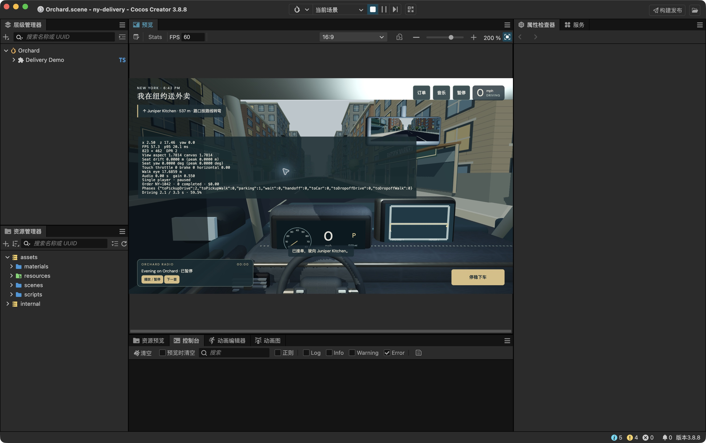
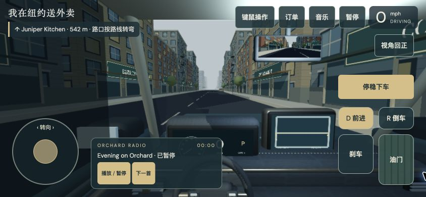

# 我在纽约送外卖

低多边形 3D 送餐驾驶游戏，使用 Cocos Creator 与 TypeScript。

汽车样片包含两个连通傍晚街区、带内饰的汽车、餐厅短交接、三种订单与连续送达结算。首个平台为电脑 Web Desktop。当前验收状态见 [验证记录](docs/VALIDATION.md)。

最终功能代码 `5c4a4c0` 已实际连续送达三单，累计 $31.50。另录普通首单164秒，包含93秒连续送餐驾驶，驾驶占82.7%。完整视频170秒，使用项目原创CC0音乐。前后截图、视频和对应SHA见 [本轮媒体](docs/media/review-20261115/README.md)。

驾驶舱有实时 mph 仪表、中控导航与后视画面。中控地图沿实际单行街道更新路线，标出餐厅和住宅停车点。

驾驶镜头固定在车内驾驶位，与车身同步移动和转向。浏览器中拖动空白处可独立观察，步行 WASD 支持横移，镜头与脚下位置同步。仪表台、方向盘、座椅和车门采用细化曲面与材质，F3 可查看驾驶位偏移诊断。


## 打开工程

安装 Cocos Creator **3.8.8**，在 Dashboard 中添加本地版本，再打开本仓库的 game 目录。

也可从仓库根目录运行，脚本自动寻找本机已安装的 3.8.8。

```bash
python3 scripts/open-editor.py
```

这个入口使用该版本支持的离线打开参数。场景中的 Delivery Demo 组件在运行时生成街区与车厢，点击编辑器顶部播放按钮预览。

本机已下载并验证官方完整编辑器包，已通过 Dashboard 添加本地 Creator 3.8.8，并导入 game 工程。

## 在 Cocos 编辑器里试玩

本机 Dashboard 已登记 Creator 3.8.8，并已导入 game 工程。

1. 在 Dashboard 的“项目”列表双击 **game**。
2. 打开 assets/scenes/Orchard.scene，顶部预览模式选择 **编辑器预览**，点击 **▶**。
3. 点击预览工具栏右侧的“最佳显示比例”，让手机和音乐栏完整显示。
4. 点一下游戏画面，可以按 **M** 播放原创电台，或直接静音接单。

驾驶时 W/S 加速与倒车，A/D 转向，空格刹车，停稳后 E 下车。步行时 W/S 前后移动，A/D 左右横移。编辑器中使用方向键观察，浏览器中拖动空白处控制视角。再次点击顶部停止按钮退出预览。场景在运行时生成，点击播放后出现街道和车厢。

脚本修改后若预览仍使用旧代码，在资源管理器右键对应脚本，选择“重新导入资源”，等到“脚本编译完成”后重启预览。



## 触屏操作

触摸设备自动显示触屏控件。电脑浏览器可点击右上角“触屏操作”试用，Cocos 编辑器预览使用 WASD 移动与驾驶，方向键独立控制观察方向。

- 驾驶时左侧摇杆转向，右侧 D/R 选择档位，按住油门行驶，按住刹车停车。
- 步行时左侧摇杆控制前后和横移，右侧空白处拖动视角。移动与观察可以分别使用一根手指。
- 右侧交互按钮随位置显示下车、排队、装袋、上车和交付。完成订单后可直接开始下一单。
- “订单”和“音乐”打开折叠面板。可以随时选择音乐来源，静音也能接单。
- “视角回正”恢复驾驶正视方向，“暂停”菜单中的“安全复位”恢复起点位置，保留当前订单与音乐。

已在浏览器横屏 844 × 390、竖屏 390 × 844 检查布局，并通过发布版踏板和摇杆实测。实体手机多点触控尚待验证。



## 构建与启动

开发脚本需要 Python 3.9+，自动测试需要 Node 22.18+。游戏没有额外 npm 依赖。

```bash
npm run doctor
npm test
npm run build
npm start
```

同一Wi-Fi手机试玩时，显式启用局域网入口。

```bash
python3 scripts/serve.py --lan --port 7467
```

终端会显示电脑局域网IP、实际端口与构建SHA，手机打开该IP地址。默认启动仍只供本机访问。实体手机连接、系统文件多选、双指、音频启动、锁屏返回和外部音乐App共存均需按真实设备验证。

我的音乐从系统文件选择MP3/WAV。音乐App收藏和会员缓存由对应App播放。系统中断后可点“恢复声音”，外部模式可一键关闭全部游戏声音。

发布构建位于 game/build/web-desktop。启动后访问 [本机试玩入口](http://127.0.0.1:7457/)，仅供运行服务的本机访问。终端按 Ctrl+C 停止服务。关闭编辑器使用应用退出菜单。

可以指定编辑器路径、构建目录与服务端口，路径含空格时保留引号。

```bash
COCOS_CREATOR="/path/to/CocosCreator.app" npm run build
python3 scripts/build.py --build-path "/path/to/output"
python3 scripts/serve.py --directory "/path/to/output/web-desktop" --port 8080
```

构建脚本核对真实退出码与启动场景产物，接受该版本的成功码 36。原始构建日志保存在本机 .local/build/creator.log。

## 完成一单

1. 点击接单。游戏电台、本地歌单、外部播放器或静音均可送单。
2. 沿 Orchard 向北行驶，在 Juniper 路口右转，沿街到 Mercer 再右转。餐厅在路口西南侧，路边有取餐停车位。
3. 停稳按 E 下车。W/S 步行，A/D 横移，拖动空白处观察。进店靠近柜台，加入取餐队列。
4. 手机码、餐袋编号和袋数共同核验。就绪后按“出示手机并核对餐袋”。手动码输入与等餐快进位于柜台的折叠操作中，快进保持音乐原速。
5. 回到车旁按“装餐并上车”。沿 Mercer 向南，经 River 左转至 Orchard 再向北，跟随导航到顾客入口。
6. 停车下车，走到门口交付。继续接单保留车、人、视角与音乐，更新本单数据和袋签。也可结束本次工作。

M 控制播放与暂停。ESC 打开暂停菜单，F3 显示位置、帧率、音频与送单各阶段计时。驾驶位直接绑定车体。

## 音乐

常态显示轻量音乐条，点击右上角“音乐”打开完整面板。

- 游戏电台提供项目原创 Evening on Orchard、River Lights。来源与录屏适用范围见 [素材记录](docs/ASSETS.md)。
- 我的音乐支持多选 MP3/WAV、默认追加、显式替换、上一首/下一首、点选和移除。默认列表循环，可选单曲循环与顺序播放一次。暂停后切歌保持暂停。
- 车载音箱在下车后随距离减弱。开启持续聆听后，步行仍保持音乐。音乐、环境和提示音分别调节。
- 使用外部播放器会关闭内部 BGM，请自行在外部 App 播放。三种游戏声音均可独立静音。
- 录屏用音乐模式仅使用已确认的原创电台或内部静音，保留本地歌单并隐藏文件名，退出后恢复此前来源和播放选择。外部与系统声音由设备和录屏工具控制。

本地文件仅在此设备播放，不上传、不持久保存，刷新后需重新选择。请选择有权播放的音频，公开录屏或直播时另行确认音乐授权。

实体手机双指操作、手机文件选择与后台恢复、外部音乐 App 与游戏同时播放尚未验证，详细设备边界见 [验证记录](docs/VALIDATION.md)。

驾驶采用简化运动学模型与几何障碍碰撞。当前构建物理后端为 Cocos Bullet / Ammo，车辆与步行位置由各自控制器维护。

## 项目记录

- [开发计划与 v0.2 电瓶车阶段](docs/PLAN.md)
- [环境诊断与恢复](docs/ENVIRONMENT.md)
- [验证结果](docs/VALIDATION.md)
- [资源来源](docs/ASSETS.md)
- [版本变化](CHANGELOG.md)
