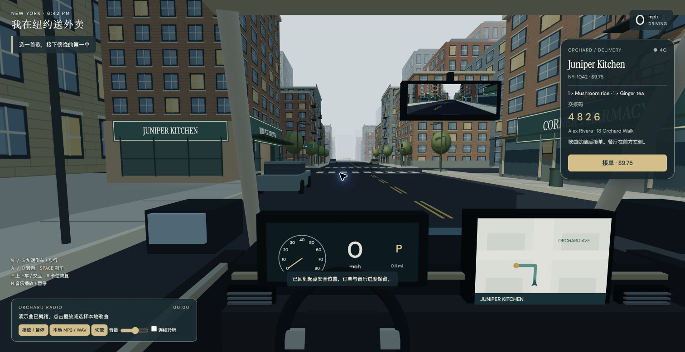
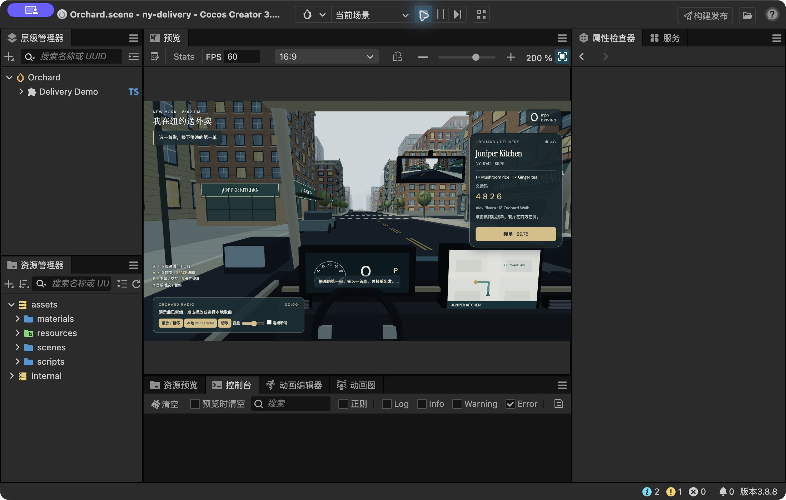

# 我在纽约送外卖

低多边形 3D 送餐驾驶游戏，使用 Cocos Creator 与 TypeScript。

汽车样片包含一段傍晚街道、带内饰的汽车、餐厅排队取餐、音乐与送达结算。首个平台为电脑 Web Desktop。当前验收状态见 [验证记录](docs/VALIDATION.md)。

驾驶舱有实时 mph 仪表、中控导航与后视画面。街道延续至远处楼群，当前可活动路段约 300 m。



## 打开工程

安装 Cocos Creator **3.8.8**，在 Dashboard 中添加本地版本，再打开本仓库的 game 目录。

也可从仓库根目录运行，脚本自动寻找本机已安装的 3.8.8。

```bash
python3 scripts/open-editor.py
```

这个入口使用该版本支持的离线打开参数。场景中的 Delivery Demo 组件在运行时生成街区与车厢，点击编辑器顶部播放按钮预览。

本机已下载并验证官方完整编辑器包，已通过 Dashboard 添加本地 Creator 3.8.8，并导入 game 工程。

## 在 Cocos 编辑器里试玩

本机 Dashboard 已登记 Creator 3.8.8，并已导入 game 工程。

1. 在 Dashboard 的“项目”列表双击 **game**。
2. 打开 assets/scenes/Orchard.scene，顶部预览模式选择 **编辑器预览**，点击 **▶**。
3. 点击预览工具栏右侧的“最佳显示比例”，让手机和音乐栏完整显示。
4. 点一下游戏画面，按 **M** 播放演示曲，再点击右侧 **接单**。

W/S 加速与倒车，A/D 转向，空格刹车，停稳后 E 下车。再次点击顶部停止按钮退出预览。场景在运行时生成，点击播放后出现街道和车厢。

脚本修改后若预览仍使用旧代码，在资源管理器右键对应脚本，选择“重新导入资源”，等到“脚本编译完成”后重启预览。



## 构建与启动

开发脚本需要 Python 3.9+，自动测试需要 Node 22.18+。游戏没有额外 npm 依赖。

```bash
npm run doctor
npm test
npm run build
npm start
```

发布构建位于 game/build/web-desktop。启动后访问 [本机试玩入口](http://127.0.0.1:7457/)，仅供运行服务的本机访问。终端按 Ctrl+C 停止服务。关闭编辑器使用应用退出菜单。

可以指定编辑器路径、构建目录与服务端口，路径含空格时保留引号。

```bash
COCOS_CREATOR="/path/to/CocosCreator.app" npm run build
python3 scripts/build.py --build-path "/path/to/output"
python3 scripts/serve.py --directory "/path/to/output/web-desktop" --port 8080
```

构建脚本核对真实退出码与启动场景产物，接受该版本的成功码 36。原始构建日志保存在本机 .local/build/creator.log。

## 完成一单

1. 播放原创演示曲，或点击“本地 MP3 / WAV”选择自己的歌曲，然后接单。
2. W 加速，S 倒车，A/D 转向，空格刹车。前方左侧为 Juniper Kitchen。
3. 停稳后按 E 下车。W/S 步行，A/D 转身。由餐厅中间入口进店，靠近柜台按 E 加入队列。
4. 队列和厨房都完成后，在手机输入 **4826**，点击“核对并取餐”。等餐快进仅推进订单计时。
5. 回到车旁按 E 装袋，再按 E 上车。沿街开往右侧 **18 Orchard Walk**。
6. 停车下车，走到门口按 E 交付，查看 $9.75 结算。点击“开始下一单”重开。

M 控制播放与暂停。R 将人和车恢复至起点安全位置，保留订单和歌曲进度。F3 显示坐标、帧率与音频诊断。车外音乐默认随距离衰减，可勾选连续聆听。

同一运行实例已连续完成两单。三张发布版截图保存在 docs/media，本机 65 秒有声录像保存在 .local/media/delivery-v01.mp4，具体证据与剩余复测见验证记录。

驾驶采用简化运动学模型与几何障碍碰撞。当前构建物理后端为 Cocos Bullet / Ammo，车辆与步行位置由各自控制器维护。

## 项目记录

- [开发计划与 v0.2 电瓶车阶段](docs/PLAN.md)
- [环境诊断与恢复](docs/ENVIRONMENT.md)
- [验证结果](docs/VALIDATION.md)
- [资源来源](docs/ASSETS.md)
- [版本变化](CHANGELOG.md)
