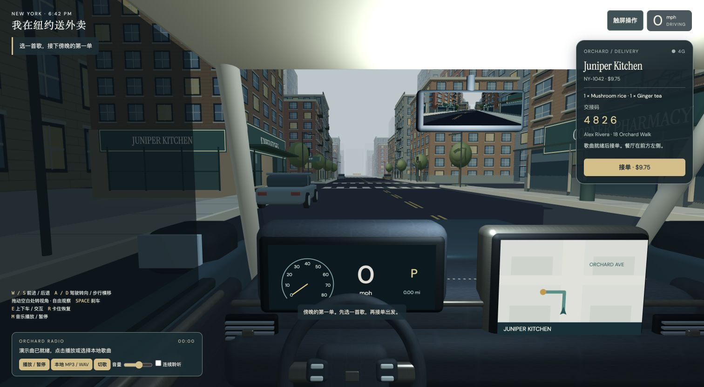
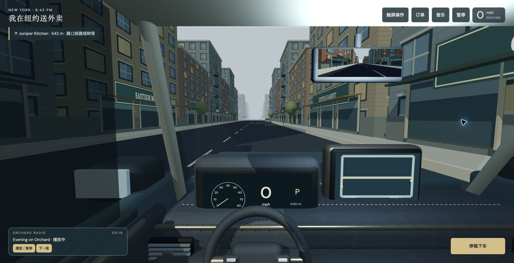
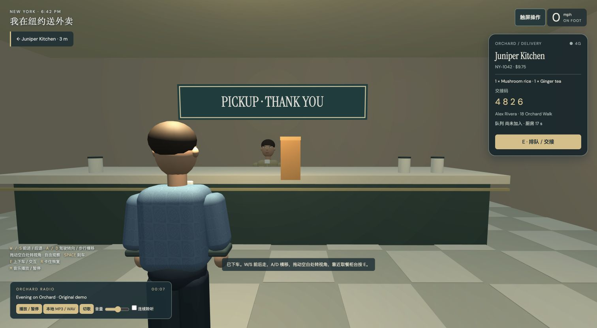
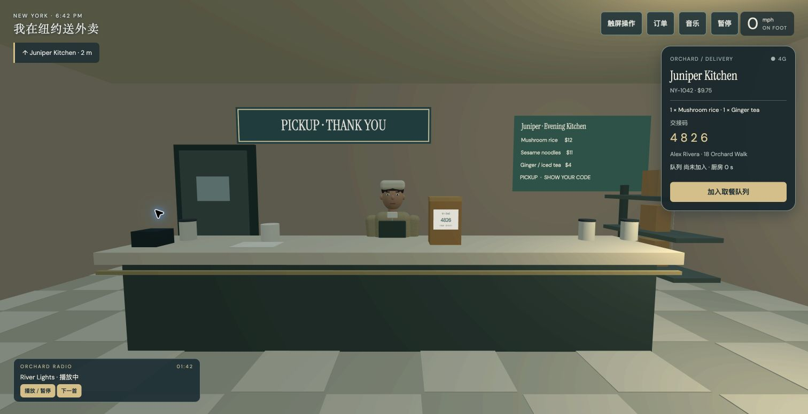
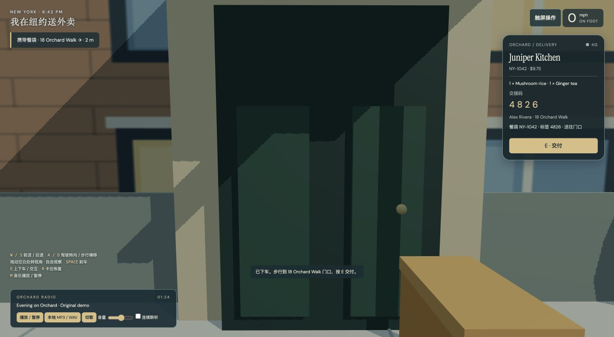
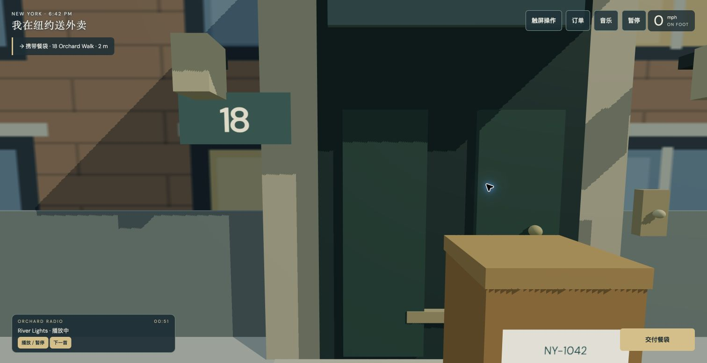

# Review 5911544318 实机媒体

本目录的最终代码为 `5c4a4c020b860510d2b633f82c6f9a0735411cb3`。前图来自执行前基线 `7baa545606f8ed94f6804cbcf7c88062ced9fbc3`。所有画面均由真实 Cocos Creator 3.8.8 发布构建或原生预览生成。

## 三个相对固定机位

| 机位 | 基线前图 | 最终后图 |
| --- | --- | --- |
| 驾驶舱，起点车内正视 | [驾驶舱前图](before-driver.jpg) | [驾驶舱后图](after-driver.jpg) |
| 餐厅柜台，面向店员及袋签 | [柜台前图](before-counter.jpg) | [柜台后图](after-counter.jpg) |
| 顾客门口，面向门牌及入口 | [入口前图](before-door.jpg) | [入口后图](after-door.jpg) |

前图视口1512×833，最终视口1512×777，均为DPR2、相机FOV70°。最终餐厅与入口随新路网搬迁，柜台和入口采用对应任务对象前的相对机位。两组视口高度、驾驶眼点与停车车道有调整，像素级构图存在差异。最终柜台观测在x337.42 / z-85.15、yaw90°，入口在x7.80 / z-360.66、yaw-90°。

### 驾驶舱

### 餐厅柜台

### 送达入口

## 完整普通单有声视频

[播放170秒完整送单视频](ordinary-delivery.mp4)。视频从接单前开始，经过驾驶、停车、进店、手机与袋签核验、拿袋、装餐并上车、连续93秒驾驶、下车交付和结算。结算为1684m、164s、$9.75，驾驶占82.7%。画面左侧保留F3验证信息，全部输入为正常键鼠操作。

- 1512×776，H.264/AAC，48kHz立体声，170.028秒，20,966,631字节。
- 原片由ScreenCaptureKit捕获该游戏窗口与应用声音，麦克风关闭。首尾截取与工具栏裁切后连续转码，无变速或中间拼接。
- 音轨平均-31.1dB、峰值-13.9dB，未检测到超过1秒的-65dB静音段。车载音箱随离车距离减弱，回车恢复，提示音短暂压低音乐。
- 录屏用音乐模式全程开启，只使用项目原创Evening on Orchard、River Lights和合成环境/提示。两首音乐的词曲素材与录音均由生成脚本产生，CC0 1.0许可、来源和适用范围见[素材记录](../../ASSETS.md)。
- SHA-256为 `690ab59fd31b347538c0befec0199bbc4d3fe44f899a185ab559f17c2c14322a`。

## 连续订单与界面证据

| 文件 | 实际内容 | 最终代码 |
| --- | --- | --- |
| [两单累计](two-orders.jpg) | NY-1043完成，累计$20.00 | 5c4a4c0 |
| [三单累计](three-orders.jpg) | NY-1044完成，累计$31.50，内部BGM关闭 | 5c4a4c0 |
| [双袋餐品](two-bags.jpg) | 6502、双袋与饮料 | 5c4a4c0 |
| [门车交互重叠](door-car-priority.jpg) | 距车3.12m、距门1.80m，交付按钮生效 | 5c4a4c0 |
| [普通单起点](ordinary-start.jpg) | 初始车内、原创电台曲与F3 | 5c4a4c0 |
| [普通单完成](ordinary-completed.jpg) | 164秒普通单结算 | 5c4a4c0 |
| [音乐录屏模式](music-recording.jpg) | 原创电台、来源/循环/独立音量 | 5c4a4c0 |
| [触屏横屏](touch-landscape.jpg) | 桌面浏览器844×390 | 5c4a4c0 |
| [触屏竖屏](touch-portrait.jpg) | 桌面浏览器390×844 | 5c4a4c0 |
| [原生Creator预览](cocos-preview.png) | 3.8.8内置预览实际静音驾驶、刹停 | 5c4a4c0 |
| [最终试玩入口](ready-to-play.jpg) | 本机7457发布版初始页面 | 5c4a4c0 |
| [运行观测](run-observations.json) | 实际可见HUD、阶段时间、音频状态和对应SHA | 5c4a4c0 |

触屏截图和控件测试使用桌面鼠标。实体手机双指、手机安全区、文件选择、音频启动/后台恢复及外部音乐App共存均未验证。原生Creator音频输出尚未验证。完整步骤、测试范围与历史版本见[验证记录](../../VALIDATION.md)。
